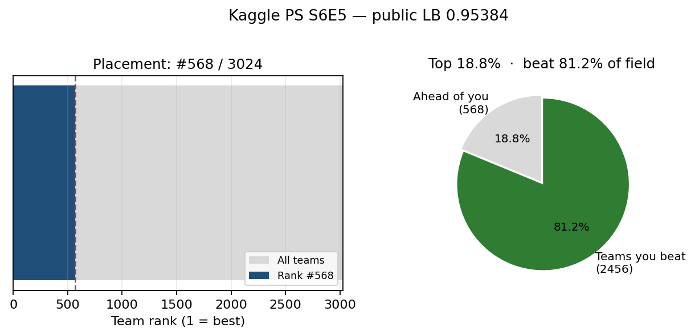
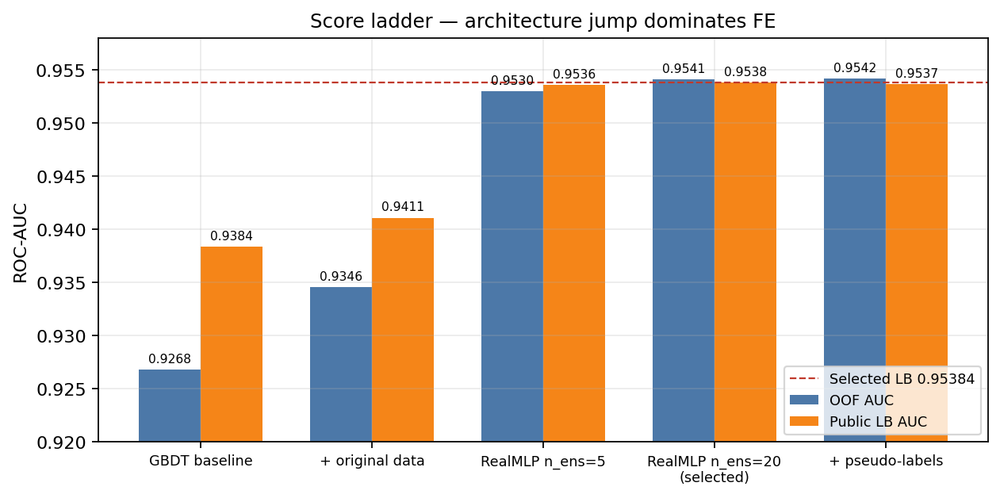
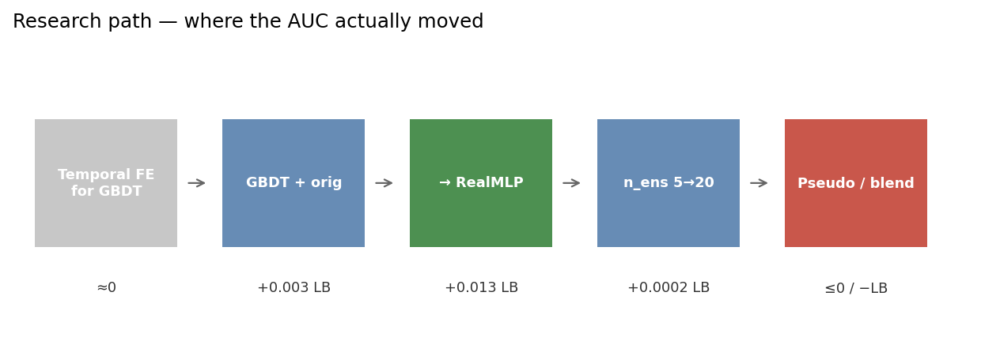
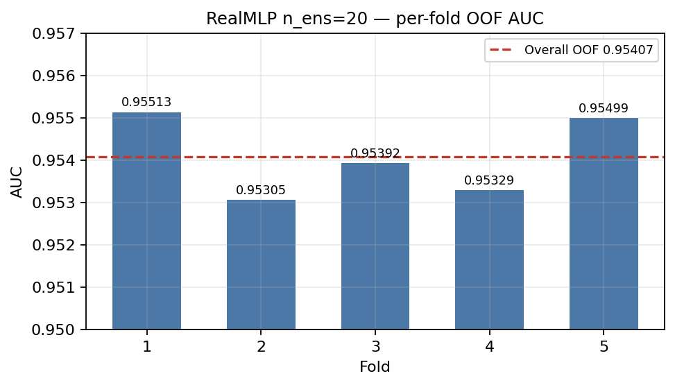
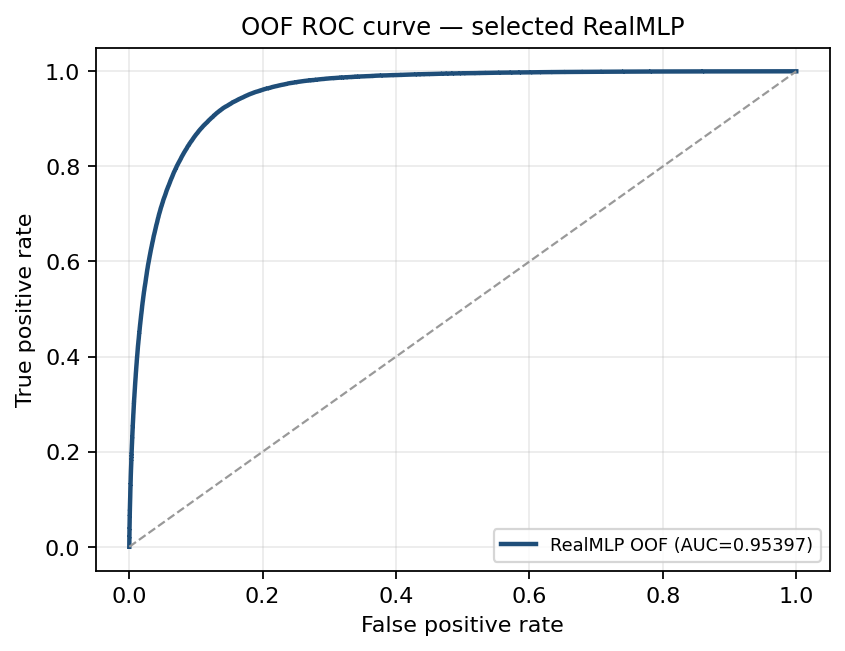
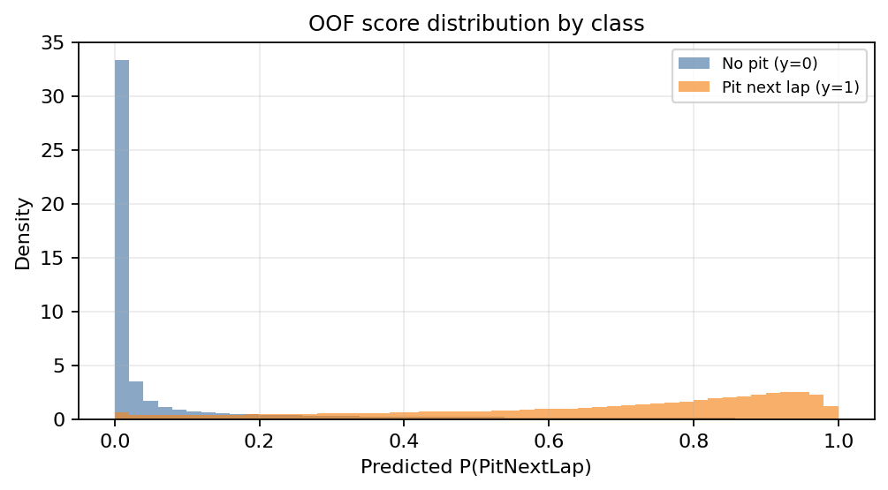
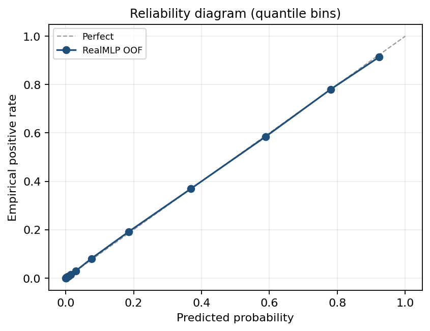

# Solution Note: F1 Pit Stop Prediction (Kaggle PS S6E5)

**Author:** ron1n97  
**Competition:** [Predicting F1 Pit Stops — Playground Series S6E5](https://www.kaggle.com/competitions/playground-series-s6e5)  
**Result:** **568th / 3024 teams (top 18.8%)** · public LB **0.95384** ROC-AUC  
**Stack:** RealMLP (pytabkit), LightGBM / XGBoost / CatBoost baselines, Target Encoding  
**Code:** this repository · [Kaggle writeup](https://www.kaggle.com/competitions/playground-series-s6e5/writeups/568th-place-solution-realmlp-original-dataset)

---

## Abstract

Binary classification: given lap-level Formula 1 state, predict whether the driver pits on the **next** lap (`PitNextLap`). Metric is ROC-AUC.

I finished **568th out of 3024 teams** — **top 18.8%** of the field, beating about **81.2%** of teams — with public LB **0.95384**. The selected model is a single **RealMLP** ensemble trained with the competition’s original source dataset. The largest gain was not exotic feature engineering; it was switching architecture from a tuned GBDT stack to RealMLP (+~0.013 public LB).



---

## 1. Problem

| | |
|---|---|
| Task | Predict `PitNextLap` ∈ {0, 1} |
| Metric | ROC-AUC |
| Train / test | ~439k / ~188k synthetic playground rows |
| Original source | ~101k rows (`f1_strategy_dataset_v4.csv`) |
| Field size | **3024** teams |
| My place | **#568** |
| Percentile | **top 18.8%** (rank / teams) |
| Public LB | **0.95384** |
| Selected OOF | **0.95407** (RealMLP `n_ens=20`) |

Positive rate in train is ~20%. Features include tyre compound and life, stint, position, lap time, cumulative degradation, race progress, and race/year identifiers.

---

## 2. Score ladder



| Approach | OOF AUC | Public LB |
|---|---|---|
| LGB + XGB + CatBoost baseline | 0.9268 | 0.9384 |
| + original dataset | 0.9346 | 0.9411 |
| RealMLP `n_ens=5` | 0.9530 | 0.9536 |
| **RealMLP `n_ens=20` (selected)** | **0.9541** | **0.9538** |
| + pseudo-labeling | 0.9542 | 0.9537 |

Selected public LB on the board: **0.95384** (rounding / submission variant of the `n_ens=20` line).



---

## 3. Method

### 3.1 Model

`RealMLP_TD_Classifier` from [pytabkit](https://github.com/LennartPurucker/pytabkit) — tabular NN ensemble with periodic linear representations, label smoothing, and a strong default transform stack. Hyperparameters largely followed [yekenot’s public notebook](https://www.kaggle.com/code/yekenot/f1-pitstop-realmlp); I did not win by inventing a new architecture.

Key knobs in the selected run: `n_ens=20`, hidden `[512, 256, 128]`, SiLU, `lr=0.019`, PLR heads, label smoothing `0.01`.

### 3.2 Training protocol

- **5-fold StratifiedKFold** (not GroupKFold by race) so Target Encoding stays useful  
- Append a fold of the **original** dataset to each training split  
- Target-encode `Race×Compound` and `Race×Year`  
- Force **CPU** on Apple Silicon — pytabkit + MPS hung in practice (~20 min/fold, ~100 min full run)

### 3.3 Features

Arithmetic interactions, floor-factorized categorical embeddings for numerical columns, count encodings, quantile bins (RaceProgress ×200, LapTime ×7), and the TE combos above. Temporal lags / rolling pace features helped almost nothing on an LGB proxy and **hurt** RealMLP OOF when added wholesale.

---

## 4. Diagnostics (selected RealMLP)



Fold AUCs for `n_ens=20`: 0.95513, 0.95305, 0.95392, 0.95329, 0.95499 → overall OOF **0.95407**.







Discrimination is strong; calibration is usable but AUC only cares about ranking — no post-hoc calibration was needed for the leaderboard metric.

---

## 5. What did not work

| Experiment | Outcome |
|---|---|
| Heavy temporal FE (lags, rolling lap times, degradation rates) | ≈0 on LGB proxy; RealMLP OOF dropped (~0.953→0.952) |
| RealMLP ↔ GBDT blends (90/10 … 70/30) | All ≤ pure RealMLP (pred correlation ~0.92) |
| Pseudo-labeling confident test rows | OOF up, public LB down |
| Optuna on LGB before architecture search | Plateau ~0.941 LB — wrong bottleneck |

Top finishers used 100–200+ model logit stacks. This note documents a **single-model** path that still cleared the top fifth of the field.

---

## 6. Takeaways

1. **Find the right model family early.** A day of GBDT temporal FE was worth less than two hours implementing RealMLP.  
2. **Original data is free signal** in Playground comps — use it.  
3. **CV scheme is a product choice.** StratifiedKFold + TE beat the “cleaner” GroupKFold recipe here.  
4. **OOF-up / LB-down tricks** (pseudo-labels, over-blending) are easy to overfit when the public board is packed.

---

## Reproduce

```bash
pip install -r requirements.txt
python download_data.py
python train_realmlp.py --no-submit
python scripts/make_figures.py
```

Full code and experiment log: repository root · [`docs/experiment_log.md`](experiment_log.md).
